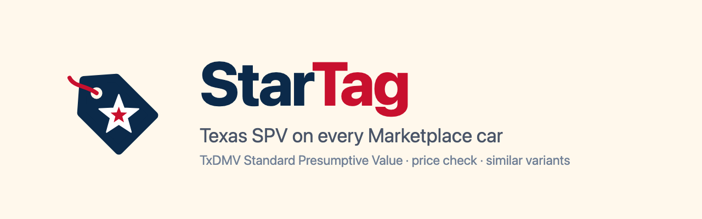

# StarTag: Texas SPV for Marketplace

Chrome extension (MV3). Shows the TxDMV Standard Presumptive Value of the vehicle on a Facebook
Marketplace listing page in a card: SPV, the model and engine of the VIN it used (and AWD), listing
price vs SPV and the SPV of similar variants of the model (click one to use it). How the value was
found, how sure the estimate is and the VIN it used are in the tooltips.

The model and engine come from the VIN, decoded with the vPIC patterns in `data/index/` (`decodeVin`
and `vinSpecs` in `src/match.js`): "2020 BMW 330i xDrive Sedan", "2.0L 4-cyl · AWD". Series and
trim are left out when the VIN does not tell them apart ("SE/XLE"), and so are chassis codes and
family names ("3-Series"). What the listing itself says (mileage, colors, seller) is not repeated.

Install: `chrome://extensions` → Developer mode → Load unpacked → this folder. Needs Chrome 116+
(`AbortSignal.any`; `world: "MAIN"` content scripts need 111).

Not affiliated with TxDMV or Meta; the card says so on every listing.

## Privacy

Before the first lookup the card shows what goes to TxDMV (the VIN and mileage; VINs built from the
year, make and model when the listing has none) and waits for **OK**. The answer is kept in
`chrome.storage` (`consent:txdmv`) for every tab; until then nothing is sent, and the background
refuses TxDMV queries on its own too (`needsConsent`). Nothing else leaves the browser: there is no
server. What is stored locally is listed in the privacy policy, `store/PRIVACY.md`, published as
[a gist](https://gist.github.com/celalertug/ff7214f00de40b35398c74f154c5055e) (linked from the card
and the store listing; update both together).

## How the VIN is chosen

SPV only takes a VIN and mileage (no year/make/model query) and only matches VIN positions 1-8 and 10
(WMI, VDS, model year); check digit, plant and serial do not change the value. Mileage changes it for
recent model years only (2017 and newer as of 2026: a 2017 Silverado is $14,125 at 1,000 miles and
$7,575 at 200,000; a 2016 Camry is the same at any mileage). The card sends the listing's odometer
(km converted) and shows it next to the vehicle; with no mileage it sends 0, which SPV answers with the
value at average mileage. So:

1. A VIN the user typed on the card for this listing ("Have the VIN?"), or a variant they picked.
2. `vehicle_identification_number` from the listing data.
3. A check-digit-valid VIN in the seller's description.
4. An earlier result for the same year/make/model/trim text, or a VIN seen on another listing of it.
5. An estimate (`src/match.js` + `src/resolver.js`):
   - **Listing text → variants.** Every vPIC variant of the year and make (model × series × trim ×
     engine × drive × fuel × body …, from `data/index/<make>.json`) is scored against the whole
     listing text: title, model, trim and description, free text included ("2016 mercedes cls 400 twin
     turbo", "F-350SD Lariat", typos like "pathfander"). Each variant carries its VIN region (allowed
     characters per position, minus excluded sub-regions).
   - **Real VIN prefixes.** `index.real` holds VIN positions 1-8 + 10 seen on real vehicles in NHTSA
     consumer complaints (64k prefixes, with counts). Each is scored like the best variant containing
     it; one no variant contains (vPIC is thin before ~2000) is scored on its NHTSA model name.
   - **Queue.** Real prefixes go first, common before rare (the counts settle what the text leaves
     open: 2.5L vs 3.5L Camry, 2WD vs 4WD trucks, diesel or not). Then VINs built from the variant
     patterns, with open positions filled by: characters SPV accepted before for that WMI (learned in
     `chrome.storage`), the shipped calibration (`data/fills.json`), the characters vPIC uses for that
     WMI around that year, then the rest. The first VIN goes alone (it is usually right), then 2 at
     a time, up to 24 candidates (cached answers included).
   - **Alternatives.** Up to 4 other likely variants with a different SPV value are listed on the card;
     clicking one makes it the value shown (remembered for the listing). Only variants whose value is
     already known (from this search or the cache) are listed at first; "Show similar variants" asks
     TxDMV for the rest (up to 12 queries).
   - **Confidence.** high: the top-scoring variant, model and trim/engine named in the text; medium:
     the model matches; low: a guess between models.

Not covered: vehicles before 1981 (no 17-character VIN), and vehicles SPV does not have (some exotics
and models that did not exist that year).

## TxDMV load

SPV is a public service; the extension keeps its queries few:

- **Cache per VIN pattern.** Every SPV answer is kept in `chrome.storage` under its pattern (VIN
  positions 1-8 and 10, all SPV reads), for every listing: values for 7 days, "not found" for 30.
  Values of model years SPV adjusts for mileage are kept per mileage. Expired entries are dropped
  once a day. A listing opened again costs no query.
- **Variants on request** (above), and the search budget counts cached answers too, so a listing
  seen again walks the same candidates from the cache instead of searching deeper.
- **Early stop.** Real prefixes are builds that exist; when SPV does not find 3 of them for the
  best-matching models, or no real prefix is left and 10 candidates were not found, SPV most likely
  does not have the model (exotics, ATVs) and the search stops. On the calibration titles every hit
  came from a real prefix or within the first 8 candidates.
- **Leaving the listing stops its queries**, and none start before the listing has been open 1.5 s
  (paging through listings sends nothing). Cached answers are shown at once.
- **One rate limit per browser**: 15 queries a minute, bursts of 6 (`src/polite.js`). After a
  timeout, a network error, 429 or 5xx, all queries pause (Retry-After, else 30 s doubling to
  15 min) and the listing stops asking.

## Files

- `src/hook.js`: page-world hook; forwards XHR/fetch responses with vehicle fields (opening a listing from the feed).
- `src/content.js`: reads the listing (forwarded responses, embedded JSON on a full load, page title as fallback), renders the card.
- `src/background.js`: service worker; runs the resolver, loads `data/`.
- `src/match.js`: listing-text parsing, variant scoring, VIN regions, real-prefix scoring, VIN decode for the card.
- `src/resolver.js`: SPV client, SPV answer cache, candidate queue, similar variants.
- `src/polite.js`: rate limit and pause after errors for all TxDMV queries of the browser.
- `tools/build_index.py`: builds `data/makes.json` and `data/index/` from `vpic.lite.db` (in the
  `@cardog/corgi` npm package, `dist/db/vpic.lite.db.gz`).
- `tools/build_real.py`: adds real VIN prefixes to `data/index/` from NHTSA's
  [FLAT_CMPL.zip](https://static.nhtsa.gov/odi/ffdd/cmpl/FLAT_CMPL.zip). Run after `build_index.py`.
- `assets/`: StarTag logo (`logo.svg`, `logo-small.svg` for 16-32 px), extension icons, README banner;
  `node tools/build_brand.mjs` regenerates them (navy `#0B2A4A`, red `#C8102E`, cream `#FFF8EC`).
- `tools/calibrate.mjs`: runs the resolver on a corpus of Marketplace titles against live SPV,
  reports the resolve rate and query counts, and merges the learned fill characters into `data/fills.json`.
- `tools/package.mjs`: builds the store upload (below).
- `tools/screenshots.mjs`: store screenshots on a real listing (below).
- `NOTICE.txt`: disclaimer and data credits, shipped in the package.
- `store/`: store listing texts and dashboard answers (`listing.md`), privacy policy (`PRIVACY.md`),
  screenshots and the small promo tile.

Rebuild: `VPIC_DB=vpic.lite.db npm run build:index && NHTSA_CMPL=FLAT_CMPL.zip npm run build:real`.

## Data and credits

The vehicle data in `data/` is built from NHTSA's vPIC catalog and NHTSA consumer complaints, both
U.S. government works in the public domain; `vpic.lite.db` comes from
[`@cardog/corgi`](https://github.com/cardog-ai/corgi) (ISC License, copyright CRDG). `NOTICE.txt`
carries the credits and the ISC notice into the package.

## Publishing (Chrome Web Store)

- `npm run package`: `dist/startag-<version>.zip` with `manifest.json`, `NOTICE.txt`, `src/`, `data/`
  and the manifest's icons only (~3.7 MB zipped, 24 MB unpacked). It fails if a file the manifest
  names or a module `src/` imports is missing. Bump `version` in `manifest.json` for each upload.
- `npm run build:brand`: also renders `store/promo-440x280.png`; the 128 px icon is 96 px artwork
  with 16 px of transparent padding, as the store asks.
- `node tools/screenshots.mjs [listingId]`: 1280×800 screenshots of the first-run notice, the card
  and its similar variants on a real listing (logged out; Facebook's login prompts are hidden), recorded with tabtape. Check them for
  seller details before uploading.
- `store/listing.md`: summary, description, category, single-purpose statement, permission
  justifications, data-usage answers and reviewer notes for the developer dashboard.

## Tests

- `npm test`: offline tests against a fake SPV (`test/offline.test.mjs`: cache, budgets, early stop,
  TxDMV errors, abort, dwell time, rate limit), then the resolver against the live SPV service
  (19 cases: free-text models, typos, trucks, motorcycles, VINs in listing/description, pre-1981).
  `npm run test:offline` runs only the first.
- `npm run test:e2e`: loads the extension in Playwright Chromium with tabtape (recorded); replays the
  recorded listing-open response (first-run notice and OK, card, collapse, drag, back), opens a Camry listing, asks for its
  similar variants and picks one, an unknown model and a typed VIN, a non-vehicle item, and the real
  listing logged out. `test/fixtures/route-def.txt` is a recorded Facebook response from your session (gitignored).
- `node tools/calibrate.mjs test/calibration-corpus.json [limit] [maxSearch] [--alts] [--stop N] [--trace file]`:
  evaluation on 100 real titles (see the header of `tools/calibrate.mjs`). With
  `SPV_ANSWERS=test/spv-answers.json` TxDMV answers are recorded and replayed, so a pattern reaches
  TxDMV once across runs.
